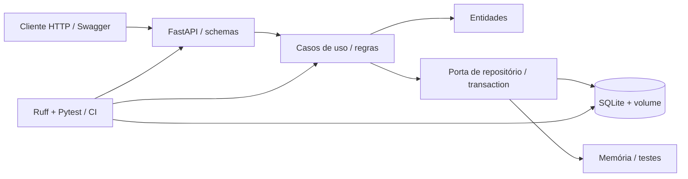
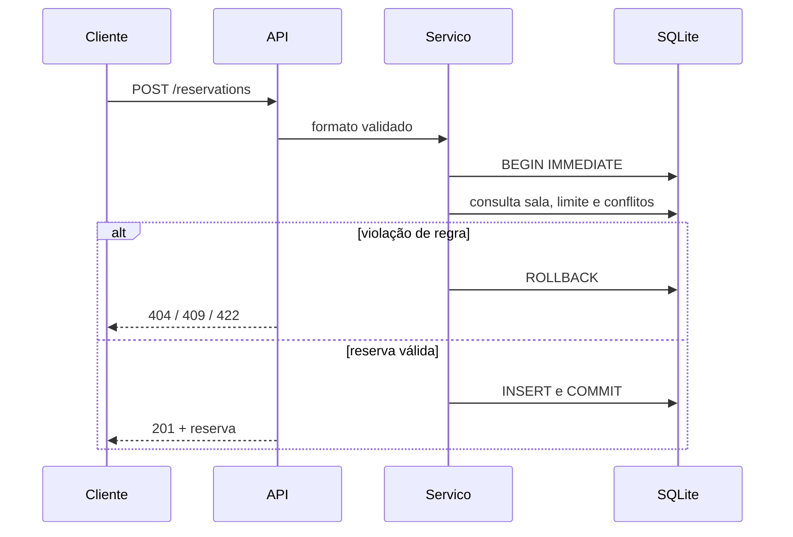

# CampusFlow - versão final 1.0.0

[](https://github.com/MorimFr/entrega-inicial/actions/workflows/ci.yml)

API local para reservar salas de estudo sem conflitos. Lista salas, cria/consulta/cancela reservas,
consulta disponibilidade e lista reservas por usuário. SQLite conserva os registros após reinícios.
Transações protegem conflito, limite diário e cancelamento sob concorrência no mesmo arquivo.

**Autor:** Felipe Amorim Monteiro - RA 22452139 (equipe individual).
**Repositório público:** <https://github.com/MorimFr/entrega-inicial>.
**Release estável planejada:** [v1.0.0](https://github.com/MorimFr/entrega-inicial/releases/tag/v1.0.0),
publicada somente após homologação do PR final e CI da main. A candidata não equivale à tag publicada.

## Execução simples com Docker

Pré-requisito: Docker Desktop/Engine iniciado e Docker Compose disponível.

```powershell
docker compose up --build -d --wait api
```

Abra **http://localhost:8000/docs** para usar o Swagger; **/health** informa liveness. A imagem
runtime executa como usuário sem privilégios e não instala ferramentas de teste. A porta é exposta
somente em 127.0.0.1. Não precisa instalar Python no computador para usar Docker.

Encerrar sem apagar dados:

```powershell
docker compose down
```

O volume nomeado `campusflow-data` armazena `/app/data/campusflow.db`. Recriar o contêiner não apaga
reservas. Faça backup do arquivo/volume com a aplicação parada quando precisar preservar dados.
Não use `down --volumes` se quiser conservá-los.

## Configuração de ambiente

Não há credenciais obrigatórias. O Compose funciona sem `.env`; `.env.example` contém os padrões.

| Variável | Uso | Padrão |
|---|---|---|
| CAMPUSFLOW_PORT | porta no host (Compose) | 8000 |
| CAMPUSFLOW_DATABASE_PATH | caminho SQLite na execução Python | data/campusflow.db |
| CAMPUSFLOW_DATABASE_PATH | caminho interno definido pelo Compose | /app/data/campusflow.db |

Para outra porta, crie `.env` com `CAMPUSFLOW_PORT=8001` (ou use variável no shell) e execute Compose.
Então abra http://localhost:8001/docs. `.env` e bancos reais não são versionados nem enviados ao build.

## Harness em comando único

```powershell
docker compose --profile test run --rm --build tests
```

O target tests executa **Ruff e a suíte completa**. O processo retorna erro se lint/teste falhar ou
coverage ficar abaixo de 90%. Os relatórios persistem no host:

```text
artifacts/test-output.log     saída real do lint/Pytest
artifacts/junit.xml           casos, falhas e duração
artifacts/coverage.xml        cobertura por módulo
artifacts/htmlcov/index.html  relatório navegável de cobertura
```

100% de passagem significa todos os testes coletados aprovados. Não significa 100% de cobertura.
Unitários, API, SQLite, rollback, fusos e concorrência estão em `tests/`. Os gates e artefatos também
rodam no GitHub Actions, incluindo execução do harness Docker e verificação do OpenAPI As-Built.

## Demonstração funcional

Com a API iniciada, execute sem Python local:

```powershell
docker compose --profile demo run --rm demo
```

O script usa dados fictícios e mostra criação 201, consulta 200, conflito 409, listagem, cancelamento
200, repetição 409 e entrada inválida 422. A saída contém um `RESERVATION_ID`. Para comprovar
persistência, recrie a API e consulte esse ID:

```powershell
docker compose up -d --force-recreate --wait api
docker compose --profile demo run --rm demo python scripts/demo_api.py --base-url http://api:8000 --reservation-id ID_COPIADO
```

O [roteiro do vídeo de 3-5 minutos](docs/DEMO.md) orienta a gravação real e a publicação do link para
o professor. O vídeo está pendente até o aluno fornecer o link; ele é obrigatório no PDF final.

## Instalação Python (opcional, desenvolvimento)

Base homologada: Python 3.12. No PowerShell:

```powershell
.\scripts\setup.ps1
.\.venv\Scripts\Activate.ps1
uvicorn campusflow.api:app --reload
```

Linux/macOS:

```bash
python3.12 -m venv .venv
source .venv/bin/activate
python -m pip install -e ".[dev]"
uvicorn campusflow.api:app --reload
```

Harness local: `python scripts/run_harness.py` (ou `.\scripts\test.ps1`). Configuração de banco local:
`$env:CAMPUSFLOW_DATABASE_PATH = "data/campusflow-local.db"` no PowerShell, ou `export` no shell Unix.
O diretório pai é criado na partida; o usuário deve ter permissão de escrita nesse caminho.

## As-Built e contratos definitivos

- [Especificação As-Built 1.0.0](docs/SPECIFICATION.md): RF-01 a RF-08, RN-01 a RN-11 e RNF-01 a RNF-07.
- [OpenAPI versionado](docs/openapi.json), também disponível em `/openapi.json`.
- Exportar: `python scripts/export_openapi.py`. Conferir: `python scripts/export_openapi.py --check`.
- [Histórico de refinamento](docs/SPEC_CHANGELOG.md) e [erros identificados](docs/LOGICAL_ERRORS.md).

Regras principais: intervalo com fuso e duração de até 2 horas; participantes inteiros positivos até
a capacidade; sem sobreposição; adjacência permitida; no máximo duas reservas ativas por usuário no
dia UTC-03 do campus. Datas de entrada usam strings ISO 8601, sem coerção de epoch. Canceladas não
bloqueiam a sala nem o limite; segundo cancelamento retorna 409.

## Arquitetura e fluxo





| ADR | Decisão |
|---|---|
| [001](docs/adr/001-arquitetura-em-camadas.md) | domínio isolado e porta substituível |
| [002](docs/adr/002-api-e-testes.md) | FastAPI, Pytest, Ruff e gate de cobertura |
| [003](docs/adr/003-persistencia-sqlite.md) | SQLite local persistente |
| [004](docs/adr/004-calendario-e-atomicidade.md) | calendário comum, tipos e transações |
| [005](docs/adr/005-release-e-empacotamento.md) | versão única, runtime/harness e release final |

## Governança e retrospectiva

`main` protegida recebe o PR de release; branches de trabalho vinculam Issues e critérios de aceite.
O check quality e a aprovação são obrigatórios. MorimFr e SrMorim pertencem a Felipe; a autorrevisão
por conta secundária segue a adaptação individual autorizada pelo professor conforme relato do aluno.
Não se afirma revisão independente entre pessoas. Consulte [governança](docs/GOVERNANCE.md).

[Retrospectiva final](docs/RETROSPECTIVE.md), [uso de IA](docs/AI_USAGE.md),
[análise ético-técnica](docs/AI_ETHICS.md) e [índice da submissão final](docs/FINAL_SUBMISSION.md).

## Limites da solução entregue

Produto homologado para uso acadêmico **local**. `user_id` é informado pelo cliente, não autentica
identidade. Não usar dados reais nem expor a API à internet sem autenticação/autorização. Catálogo
fixo de duas salas; sem notificações, interface web própria ou implantação distribuída entre hosts.
Não há política de antecedência (datas passadas não são rejeitadas). Limites estão no As-Built;
não são funcionalidades prometidas como implementadas.

## Histórico e licença

As releases das Entregas 1/2 e seus logs/PDFs permanecem preservados. A documentação vigente da
conclusão é o As-Built e os artefatos da release estável. Código: [licença MIT](LICENSE).
